<!-- Generated from .github/profile/README.template.md and .github/profile/sections/. -->

<picture>
  <source media="(prefers-color-scheme: dark)" srcset="./assets/hero-animated-dark.svg" />
  <source media="(prefers-color-scheme: light)" srcset="./assets/hero-animated-light.svg" />
  
</picture>

  <strong>English</strong> · <a href="./README.zh-CN.md">简体中文</a>

  Open-source work on AI agents, AI-native applications, and AI algorithms.

  
  

## 🚀 About Me

I'm **cmyk-labs**, an open-source contributor dedicated to building practical, reliable AI applications that solve real-world problems more effectively.

- 🎓 **Education**: B.Eng. (2021–2025) · Major in Data Science and Big Data Technology · Department of Big Data and Artificial Intelligence
- 🎯 **Research Interests**: AI agents, AI-native applications, and AI algorithms
- 🌱 **Collaboration**: Open to technical discussions and open-source collaboration in these areas.

## 📦 Open Source

<table>
  <tr>
    <td width="50%" valign="top">
      &nbsp;<strong><a href="https://github.com/cmyk-labs/web2harness">cmyk-labs/web2harness</a></strong>
       
      Use ChatGPT web models, including Pro when available to your account, in Codex with native tool calls, task context, streaming, and image inputs, plus an experimental option to triple the context budget. Web-model requests use ChatGPT web limits without consuming Codex quota; the default Native Tools mode requires no MCP connector or tunnel.
    </td>
    <td width="50%" valign="top">
      <a href="https://github.com/cmyk-labs/hands-on-computing"><picture><source media="(prefers-color-scheme: dark)" srcset="https://raw.githubusercontent.com/cmyk-labs/hands-on-computing/main/docs/assets/logo-en-dark.png" /></picture></a>&nbsp;<strong><a href="https://github.com/cmyk-labs/hands-on-computing">cmyk-labs/hands-on-computing</a></strong>
       
      A hands-on computing tutorial built around Jupyter Notebooks, connecting principles, code experiments, and projects on a path from programming fundamentals to AI engineering.
    </td>
  </tr>
</table>

## ✨ Featured Contributions

<table>
  <tr>
    <td valign="top">
      
      &nbsp;<strong><a href="https://github.com/bytedance/deer-flow">bytedance/deer-flow</a></strong>
       
      An open-source SuperAgent Harness built on LangGraph and LangChain, integrating task planning, Sub-Agent coordination, sandboxed execution, long-term memory, and extensible Skills for complex research, coding, and content creation workflows.
    </td>
  </tr>
  <tr>
    <td>
      &nbsp; <strong><a href="https://github.com/bytedance/deer-flow/pull/4937">PR #4937</a> · Dispatch user-scoped custom agents via task()</strong>
       
      Addressed the inability of the Lead Agent to delegate to the current user’s Custom Agents through task / batch_task. Extended Sub-Agent registration and resolution with a shared precedence order—built-in, operator-configured, administrator-managed, then user-defined—preventing lower-priority definitions from overriding higher-priority agents. Integrated the target agent’s SOUL prompts, Skills, model and reasoning settings into execution, preserved the parent user identity and delegation policy, and revalidated model authorization before tool selection. Mapped tool groups to strict allowlists that deny tool access when resolution fails. This enables the Lead Agent to delegate dynamically to Custom Agents as specialized workers for individual and batch tasks.
    </td>
  </tr>
</table>

 

<table>
  <tr>
    <td valign="top">
      
      &nbsp;<strong><a href="https://github.com/loopx-project/loopx">loopx-project/loopx</a></strong>
       
      An open-source control plane for long-horizon agents and agent teams, preserving goals, tasks, decisions, and execution evidence to support cross-session execution, recovery, and human-agent collaboration with Codex, Claude Code, and other runtimes.
    </td>
  </tr>
  <tr>
    <td>
      &nbsp; <strong><a href="https://github.com/loopx-project/loopx/pull/3527">PR #3527</a> · Add bounded segment milestone trigger</strong>
       
      Addressed missing stage-progress report triggers in long-running Agent Loops. Added a bounded-segment milestone rule that validates stage identity, state transitions, and durable writeback before recognizing stage completion or entry into replanning as reportable events. Integrated the rule into the weekly reporting preset with an assigned priority, reusing the existing milestone_update report channel, cooldown, and event coalescing. Long-running tasks can now qualify for progress reports at intermediate milestones while unfinished todos remain.
        
      &nbsp; <strong><a href="https://github.com/loopx-project/loopx/pull/3554">PR #3554</a> · Promote durable runtime milestones</strong>
       
      Addressed the missing connection between runtime events and stage-milestone rules. Added provider-neutral event aggregation that consumes caller-supplied durable execution events, validates bounded event windows, goal identity, and aggregation limits, and deduplicates events and completed-todo counts. When completion counts reach the configured threshold or a durable autonomous replan is detected, it submits milestone candidates to the existing trigger evaluator, reusing history deduplication and cooldown. Preserved aggregation identity and configuration through report composition, enabling runtime progress to become stage-report trigger decisions within the existing reporting pipeline.
    </td>
  </tr>
</table>

---

  Visuals adapt to your GitHub theme, while repository stars, pull request statuses, rankings, and summaries refresh automatically.

